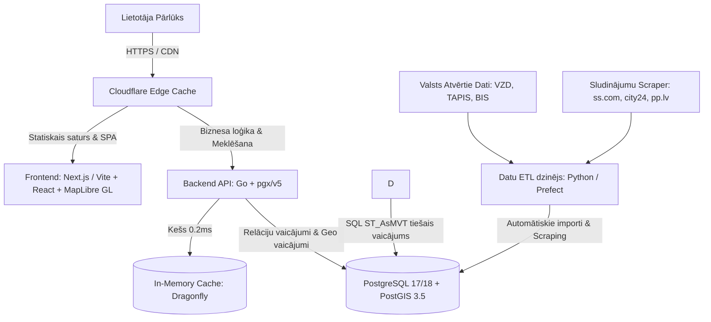

# Tehniska un Funkcionāla Specifikācija: Latvijas Kadastra un Nekustamo Īpašumu Kartes Platforma

> **Mērķis:** Izveidot pilnīgi neatkarīgu, modernu un mērogojamu nekustamo īpašumu un ģeotelpisko datu platformu, kas vienuviet apvieno kadastra datus, vēsturiskos darījumus, tirgus sludinājumus, teritorijas plānojumu, būvniecības procesus un vides riskus.
>
> [!IMPORTANT]
> **Datu Neatkarības Pamatprincips:**
> `kadastrakarte.lv` projektā kalpo **TIKAI kā vizuālais un funkcionālais etalons/paraugs** (UI/UX paraugs un arhitektūras reversās inženierijas atsauce).
> **Visiem datiem ražošanā (production) obligāti jānāk no primārajiem ārējiem valsts atvērtajiem avotiem (VZD, VMD, TAPIS, BIS, LVĢMC, DAP, BVKB u.c.) un mūsu pašu sludinājumu robotiem (scrapers).**
> Jebkādi pagaidu starpniekserveri (proxy / static snapshots) no `kadastrakarte.lv` tiek pakāpeniski aizstāti ar mūsu pašu datubāzes ETL cauruļvadiem (skatīt 1.3. sadaļu).

---

## 1. Vietnes `kadastrakarte.lv` Tehniskā Analīze (Reversā Inženierija)

Veicot vietnes padziļinātu analīzi, tika atklāta tās patiesā iekšējā uzbūve un datu plūsma:

### 1.1. Klienta puse (Frontend)
- **Kartes dzinējs:** `MapLibre GL JS` (v4.7.1) — atvērtā koda WebGL bibliotēka, kas nodrošina 60 FPS vektoru un rastra flīžu renderēšanu bez Mapbox licences ierobežojumiem.
- **Pamatkartes:**
  - Vektoru bāzes karte: `OpenFreeMap` ar *Positron* stilu (`https://tiles.openfreemap.org/styles/positron`), balstīta uz OpenStreetMap un OpenMapTiles.
  - Satelīta / aerofoto slānis: `Esri World Imagery` (alternatīvi pieejams LĢIA bezmaksas WMTS ortofoto).
- **Līmeņu (Zoom) stratēģija:**
  - **Tālummaiņa $Z < 14$:** Sludinājumi un darījumi tiek klasterēti pārlūkā, izmantojot iepriekš aprēķinātus statiskus GeoJSON datus (`lst-pts.json`, `tx-pts.json`), lai nepārslogotu serveri.
  - **Tālummaiņa $Z \ge 14$:** Tiek ielādēti dinamiskie vektoru flīžu (MVT) slāņi no servera konkrētajam ekrāna apgabalam (`parcels`, `buildings`, `mv_tiles_zv`, utt.).
- **Datu vizualizācija:** `Chart.js` (darījumu cenu vēsturei, €/m² dinamikai, energoefektivitātes salīdzinājumam).
- **Lietotāja saskarne:** Responsīvs panelis (desktopā bīdāms labās puses panelis, mobilajās iekārtās — apakšējais izbīdāmais *bottom sheet* ar `100dvh`).

### 1.2. Servera puse (Backend & Tile Server)
- **Vektoru flīžu serveris:** **Martin** (Rust bāzēts MVT serveris). Tā konfigurācija eksponē **49 vektoru slāņus** tieši no PostgreSQL/PostGIS tabulām un materializētajiem skatiem caur URL formātu: `/tiles/{table_or_view}/{z}/{x}/{y}`.
- **API slānis:** PHP skripti ar JSON atbildēm (piemēram, `/api/parcel-info.php`, `/api/building-info.php`, `/api/deals-geojson.php`, `/api/popup-signals.php`).
- **Kešošana:** Cloudflare CDN priekšplānā vektoru flīžu un statisko resursu ātrai piegādei.

### 1.3. Pašreizējais Datu Avotu Audits (Mūsu Dati vs Pagaidu Parauga Dati)

| Komponente / Slānis | Pašreizējais Avots | Primārais Ārējais Avots (Nākotnes Mērķis) | Statuss |
| :--- | :--- | :--- | :--- |
| **Bāzes karte** | OpenFreeMap Positron | OpenFreeMap / OSM | ✅ 100% Neatkarīgs |
| **Satelīta aerofoto** | Esri World Imagery | Esri / LĢIA Ortofoto WMTS | ✅ 100% Neatkarīgs |
| **Rīgas zemes vienības & būves** | Mūsu PostGIS DB (`kartes-db`) | VZD Kadastra atvērtie dati (`data.gov.lv`) | ✅ 100% Neatkarīgs (nepieciešams paplašināt visai LV) |
| **Adrešu reģistrs** | Mūsu PostGIS DB (`kartes-db`) | VZD Valsts adrešu reģistrs (`data.gov.lv`) | ✅ 100% Neatkarīgs |
| **Ēku energosertifikāti** | Mūsu Martin (`/tiles/energy_certificates/`) | BVKB atvērtie dati (`data.gov.lv`) | ✅ 100% Neatkarīgs |
| **Piesārņotās vietas** | Mūsu Martin (`/tiles/pollution_sites/`) | VVD atvērtie dati (`data.gov.lv`) | ✅ 100% Neatkarīgs |
| **VZD Darījumu vēsture (Rīga)** | Mūsu PostGIS DB (`kartes-db`) | VZD NĪTB atvērtie dati (`data.gov.lv`) | ✅ 100% Neatkarīgs |
| **Sludinājumu punkti kartē** | Pagaidu fails `web/public/data/listings-pts.json` (no kadastrakarte.lv) | Pašu crawler/skreiperis (ss.com, city24, pp.lv) | ⚠️ Pagaidu paraugs |
| **Darījumu klasteru punkti (Z < 14)** | Pagaidu fails `web/public/data/tx-pts.json` (no kadastrakarte.lv) | Automātiska ģenerēšana no mūsu `transactions` tabulas | ⚠️ Pagaidu paraugs |
| **Vektoru flīzes ārpus Rīgas & papildslāņi** | Nginx `proxy_pass` uz `kadastrakarte.lv/tiles/` | Mūsu PostGIS + Martin ar pilnajiem LV datiem | ⚠️ Pagaidu proxy |
| **API zemes vienības info (ārpus Rīgas)** | Go API fallback uz `kadastrakarte.lv/api/parcel-info.php` | Mūsu Go API ar visas Latvijas kadastra tabulu | ⚠️ Pagaidu fallback |

---

## 2. Datu Avotu Reģistrs (Kur un Kā Iegūt Datus)

Visi platformā nepieciešamie dati ir publiski pieejami kā Latvijas valsts iestāžu **Atvērtie dati** (Open Data), izņemot sludinājumu datus, kuri tiek vākti ar skreiperiem.

| Datu kopa | Iestāde / Avots | Formāts & Protokols | Atjaunošanās | Piekļuve / Saite |
| :--- | :--- | :--- | :--- | :--- |
| **Zemes vienības (Kadastrs)** | Valsts zemes dienests (VZD) | GeoPackage / SHP / WFS | Katru mēnesi / ceturksni | [data.gov.lv: Kadastra telpiskie dati](https://data.gov.lv/dati/lv/dataset/kadastra-informacijas-sistemas-atvertie-telpiskie-dati) |
| **Būvju kontūras & parametri** | VZD | SHP + CSV (teksta dati) | Katru mēnesi | [data.gov.lv: Būves un to parametri](https://data.gov.lv/dati/lv/dataset/kadastra-informacijas-sistemas-atvertie-teksta-dati) |
| **NĪ Tirgus Darījumi (NĪTB)** | VZD | CSV / XLSX / GeoJSON | Katru mēnesi / ceturksni | [data.gov.lv: Nekustamā īpašuma darījumu dati](https://data.gov.lv/dati/lv/dataset/nekustama-ipasuma-tirgus-darijumu-dati) |
| **Adrešu reģistrs (VAR)** | VZD | CSV ar koordinātēm (LKS-92 & WGS84) | Katru nedēļu | [data.gov.lv: Adrešu reģistrs](https://data.gov.lv/dati/lv/dataset/valsts-adresu-registra-informacijas-sistemas-atvertie-dati) |
| **Teritorijas plānojums & Zonējums** | TAPIS (VARAM) / Geolatvija | GeoPackage / WFS / WMS | Pēc pašvaldību grozījumiem | [geolatvija.lv/geo/tapis](https://geolatvija.lv/geo/tapis) |
| **Būvniecības lietas & atļaujas** | BIS / BVKB | CSV / REST API | Katru dienu / nedēļu | [data.gov.lv: BIS dati](https://data.gov.lv/dati/lv/dataset/buvniecibas-ieceres-un-buvatlaujas) |
| **Ēku energosertifikāti** | BVKB | CSV / Atvērtie dati | Regulāri | [data.gov.lv: Energosertifikāti](https://data.gov.lv/dati/lv/dataset/energosertifikati) |
| **Plūdu riska kartes** | LVĢMC | SHP / WFS / WMS | Pēc hidro-modelēšanas | [videscentrs.lvgmc.lv](https://videscentrs.lvgmc.lv/) |
| **Piesārņotās vietas (PPVR)** | LVĢMC | CSV / SHP / WFS | Reizi mēnesī | [videscentrs.lvgmc.lv: PPVR](https://videscentrs.lvgmc.lv/) |
| **Trokšņu kartes** | LVĢMC / Satiksmes min. | Rastra / SHP slāņi | Pēc 5 gadu cikla | [videscentrs.lvgmc.lv](https://videscentrs.lvgmc.lv/) |
| **Aizsargājamās teritorijas & mikroliegumi** | Dabas aizsardzības pārvalde (DAP) | WFS / SHP (OZOLS sistēma) | Regulāri | [ozols.gov.lv / data.gov.lv](https://data.gov.lv/dati/lv/dataset/dabas-datu-parvaldibas-sistemas-ozols-dati) |
| **Mežu nogabali (MVR)** | Valsts meža dienests (VMD) | GeoPackage / SHP | Reizi ceturksnī | [data.gov.lv: Meža valsts reģistrs](https://data.gov.lv/dati/lv/dataset/meza-valsts-registrs) |
| **Zemes nosēšanās (InSAR)** | Copernicus EGMS | NetCDF / CSV / GeoJSON | Ikgadējs satelītu cikls | [egms.land.copernicus.eu](https://egms.land.copernicus.eu/) |
| **Uzņēmumi adresē** | Uzņēmumu reģistrs (UR) | CSV | Katru dienu | [data.gov.lv: UR reģistrs](https://data.gov.lv/dati/lv/dataset/ur-juridiskas-personas) |
| **Vidi degradējošās ēkas (Grausti)** | Rīgas dome (RDĪD) & pašvaldības | JSON / CSV | Regulāri | [grausti.riga.lv](https://grausti.riga.lv/) |
| **Sludinājumi (ss.com, city24, pp.lv)** | Nekustamo īpašumu portāli | Web Scraping (HTML/JSON) | Reizi dienā / stundā | Pašu izveidots crawler ar adrešu piesaisti |

---

## 3. Ieteicamais Tehnoloģiskais Steks (Modernā Arhitektūra)

Kadastrakarte.lv izmanto PHP un monolītu HTML/JS pieeju ar Martin. Lai iegūtu labāku uzturamību, augstāku veiktspēju un ērtu attīstību, ieteicams šāds moderns steks:

> **Infrastruktūras princips:** 100% Docker vide (viss tiek būvēts un darbināts konteineros, lokāli netiek instalēts nekas ārpus Docker).

### 3.1. Datu bāze un ĢIS kodols: PostgreSQL 17/18 + PostGIS 3.5
- **Ģeometrijas:** Visas ģeometrijas glabājas `GEOMETRY` laukos.
- **Projekcija:** Oriģinālie dati no VZD nāk **LKS-92 (EPSG:3059)**. Datu importēšanas laikā tie jātransformē uz **Web Mercator (EPSG:3857)** ātrai MVT flīžu ģenerēšanai.
- **Indeksi:** Telpiskie indeksi `USING GIST (geom)` uz visām ģeometrijām.
- **Meklēšana:** Paplašinājums `pg_trgm` adrešu tūlītējai autofinišēšanai (`address-suggest`).

### 3.2. Vektoru Flīžu Dzinējs: Martin (Rust)
- Izstrādāts MapLibre komandā.
- Savienojas tieši ar PostGIS un uzreiz ģenerē `application/x-protobuf` MVT flīzes bez starpniekiem.
- Nodrošina zemu aizkavi (latenci < 5-15 ms lokāli) un minimālu RAM patēriņu.
- Atbalsta dinamiskos filtrus un materializētos skatus (piem., darījumu filtrēšana pēc gada vai summas).

### 3.3. Backend API: Go (Golang) + pgx/v5 + Dragonfly Cache
- **Valoda:** Go 1.23+. Kompilēts statisks mašīnkods minimālā Docker konteinerā (~15 MB).
- **PostgreSQL pūls:** `pgx/v5/pgxpool` ar pastāvīgi uzturētiem savienojumiem (0 ms pieslēgšanās virsizmaksas).
- **In-Memory Kešs:** `Dragonfly` (C++ bāzēts Redis aizstājējs), kas nodrošina adrešu meklēšanas un biežāko kadastru atgriešanu < 0.2 ms laikā.

### 3.4. Klienta Dzinējs: MapLibre GL JS + Moderns Web Ietvars
- **Dzinējs:** `maplibre-gl` (v4 vai v5).
- **Ietvars:** `React 18/19` ar `Vite` vai `Next.js` (TypeScript). Nodrošina moduļu struktūru, atšķirībā no 2 MB liela viena HTML faila.
- **Stils un Komponentes:** `Tailwind CSS` ar pielāgotu dizaina sistēmu un `shadcn/ui` vai pielāgotiem bīdāmajiem paneļiem.
- **Grafiki:** `Recharts` vai `Chart.js` — darījumu cenu tendencēm un tirgus analītikai.
- **Stāvokļa pārvaldība:** URL sinhronizācija (`nuqs` vai `zustand`) — katram slānim, koordinātei un atvērtajam īpašumam ir unikāls URL (piem., `?layers=parcels,deals&ll=56.98,24.01&z=16`).

### 3.4. ETL & Datu Ievākšanas Dzinējs (Data Pipeline)
- **Valoda:** Python 3.11+.
- **Bibliotēkas:** `geopandas`, `shapely`, `psycopg3`, `SQLAlchemy`, `httpx`, `playwright` (sludinājumu skreipošanai).
- **Geokodētājs:** Skreipotajiem sludinājumiem adrese tiek normalizēta un saskaņota ar VZD Adrešu reģistru (`adrese_id` un precīzs ēkas/zemes kadastra numurs).

---

## 4. Datu Bāzes Shēmas Pamatstruktūra (Būtiskākās Tabulas)

Lai nodrošinātu 49 slāņu darbību, datubāzē nepieciešamas šādas pamata struktūras:

1. `parcels` — Zemes vienības (kadastra apzīmējums, platība, lietošanas mērķi, kadastrālā vērtība, `geom`).
2. `buildings` — Būves (kadastra apzīmējums, zemes kadastrs, stāvi, materiāls, nolietojums %, būvniecības gads, `geom`).
3. `addresses` — Valsts adrešu reģistrs (adrese, iela, mājas numurs, pilsēta, pagasts, pasta indekss, `geom`).
4. `transactions` — VZD NĪTB darījumi (darījuma ID, kadastra apzīmējums, datums, summa, platība, cena par m², tips: zeme / zeme ar būvi / dzīvoklis, `geom`).
5. `listings` — Sludinājumi no portāliem (portāls, ārējais ID, adrese, kadastrs, cena, m² cena, istabas, apraksts, bildes, statuss: aktīvs/arhīvs, `geom`).
6. `listing_price_history` — Sludinājumu cenu izmaiņas laika gaitā (datums, jaunā cena, atlaide).
7. `tapis_zoning` — Teritorijas plānojuma funkcionālais zonējums (kods: DzM, JC, DA utt., apraksts, `geom`).
8. `bis_cases` — Būvniecības lietas un stadijas (numurs, veids: jaunbūve/rekonstrukcija/nojaukšana, statuss, akta datums).
9. `energy_certificates` — Ēku energosertifikāti (ēkas kods, klase A-G, kWh/m² gadā, CO₂, derīguma termiņš).
10. `environmental_risks` — Plūdu zonas (10, 100, 200 gadi), piesārņotās vietas, trokšņu slieksnis dB.

---

## 5. Implementācijas Fāzes (Ceļa Karte)

### 1. Fāze: Datu Bāzes un Infrastruktūras Pamats
- PostgreSQL + PostGIS servera uzstādīšana ar Docker.
- VZD atvērto datu lejupielādes skriptu izveide (Zemes vienības, Būves, Adreses).
- Datu transformācija no LKS-92 uz WGS84/Web Mercator un ielāde PostGIS.
- **Martin** uzstādīšana un pirmās `parcels` un `buildings` MVT plūsmas pārbaude.

### 2. Fāze: Kartes Lietotāja Saskarne (Frontend MVP)
- Vite + React + MapLibre GL JS projekta struktūra.
- Bāzes kartes integrācija (OpenFreeMap Positron + Esri / LĢIA ortofoto pārslēdzējs).
- Vektoru slāņu stilošana (zemes robežas, ēku silueti, adrešu uzraksti).
- Īpašuma klikšķa identifikācija (`click` uz zemes vai ēkas) un informācijas paneļa atvēršana.

### 3. Fāze: Darījumu Dati un Tirgus Analītika
- VZD vēsturisko darījumu (NĪTB) ielāde datubāzē.
- Materializēto skatu izveide darījumu slāņiem (`mv_tiles_zv`, `mv_tiles_zvb`, `mv_tiles_tg`).
- Darījumu punktu un klasteru renderēšana atkarībā no zoom līmeņa.
- Cenu vēstures grafiku pievienošana īpašuma kartītē.

### 4. Fāze: Sludinājumu Dzinējs (ss.com, city24, pp.lv)
- Ievākšanas robotu (scrapers) izstrāde ar aizsardzību pret bloķēšanu.
- Datu normalizēšanas un geokodēšanas algoritms (sasaiste ar VZD adresēm).
- Cenu izmaiņu fiksēšana (dienas snapshot salīdzināšana) un tirgus ilguma aprēķins.
- Sludinājumu rādīšana kartē un saraksta filtrs.

### 5. Fāze: Papildslāņi un Vides Riski
- TAPIS zonējuma un apgrūtinājumu integrācija.
- BIS būvniecības un energosertifikātu piesaiste.
- LVĢMC plūdu un piesārņojuma slāņu pievienošana.
- Automātisks īpašuma "Signālu / Riska pārbaudes" logs (zaļš/dzeltens/sarkans statuss).

---

## 6. Juridiskie Aspekti un Licences
1. **Valsts atvērtie dati:** Saskaņā ar Latvijas Informācijas atklātības likumu un `data.gov.lv` noteikumiem, VZD, TAPIS, BIS, DAP un LVĢMC dati ir atvērtie dati, kurus atļauts izmantot bez maksas arī komerciālos nolūkos, norādot atsauci uz datu avotu.
2. **Sludinājumu dati:** Datu iegūšanā (scraping) jāievēro autortiesību un datubāzu aizsardzības principi (datu agregācija faktiem, adresei un cenai ir pieļaujama, bet nav ieteicams neatļauti tieši kopēt autoru pilnos tekstus vai personu datus).
